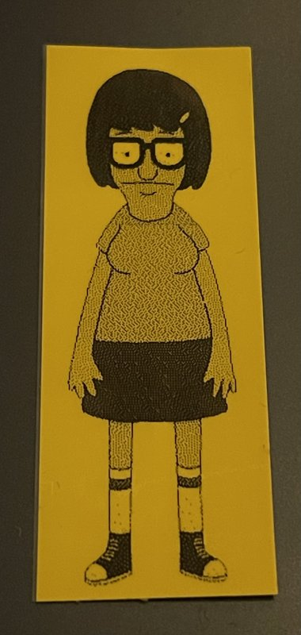

# PT label



Batch-print CSV rows and images to Brother PT-E550W/P750W label printers as **one job**, so the
printer doesn't waste a space on every label by printing the little human-friendly leader gap.

Labels are joined by half-cuts — the label layer is cut, the backing stays in one strip — with the
printer's minimum 2mm margin either side. Only the first label of a job pays the leader.

This tool is built on [ptouch](https://pypi.org/project/ptouch/) for tape geometry and rasterising. It adds the multi-label job sequence verified on real hardware, a `/dev/usb/lp0` connection, status/progress
reading, CSV text rendering and image dithering.

## Quick Install

```sh
uv tool install git+https://github.com/awfulwoman/ptlabel
```

NOTE: you need to add your user to the `lp` group to access the printer.

<details>
  <summary>Advanced install</summary>

## Install

The printer appears as `/dev/usb/lp0`, owned by `root:lp`. To print without `sudo`, add yourself to
the `lp` group.

### Ubuntu and Fedora

The command is the same on both:

```sh
sudo usermod -aG lp "$USER"
```

Log out and in again (or open a new SSH session), then check:

```sh
id -nG          # should include lp
ptlabel status
```

A running process keeps the groups it started with. Terminals inside an existing tmux or other
multiplexer session won't see the change until that session is restarted. To use the group straight
away without logging out, run one command at a time with `sg lp -c 'ptlabel status'`.

If `/dev/usb/lp0` doesn't exist when the printer is plugged in and on, check that the `usblp` kernel
module is loaded with `lsmod | grep usblp`, and load it with `sudo modprobe usblp`.

</details>

## Usage

```sh
ptlabel status                                   # model, tape width, errors

ptlabel csv items.csv                            # first column, one label per row
ptlabel csv items.csv --template '{name}\n{tag}' # two lines per label
ptlabel images logo.png photo.jpg --copies 5     # images, dithered to black and white
```

Tape width is read from the printer. Options for both `csv` and `images`:

| Option | Default | Meaning |
|---|---|---|
| `--cut half\|full` | `half` | cut between labels |
| `--cut-every N` | last label | full cut every N labels (1–99) |
| `--margin MM` | `2` | blank tape either side of each label (minimum 2) |
| `--chain` | off | leave the last label in the printer; the next job pushes it out instead of wasting a new leader. Use for every job of a run except the last |
| `--output FILE` | | dry run: write the raster job to a file |
| `--preview DIR` | | dry run: save each label as a PNG |
| `--tape MM` | `24` | dry runs only: tape width to lay out for (3.5, 6, 9, 12, 18 or 24). Real prints always use the tape the printer reports |
| `--printer PATH` | `/dev/usb/lp0` | or env `PTLABEL_PRINTER` |

`csv` also takes `--font` (env `PTLABEL_FONT`) and `--min-length MM`. `images` takes `--rotate`
(`auto` turns portrait images so the long side runs along the tape).

## Image sizes

The printer prints 180 dots per inch (about 7.09 per mm), and the dots are square. Make an image's
**height** the tape's printable width in pixels. Its **width** becomes the label length.

| Tape | Image height | Printable width |
|---|---|---|
| 24mm | 128px | ~18mm |
| 18mm | 112px | ~15.8mm |
| 12mm | 70px | ~9.9mm |
| 9mm | 50px | ~7mm |
| 6mm | 32px | ~4.5mm |
| 3.5mm | 24px | ~3.4mm |

- **Width:** label length × 7.09. For example, a 50mm label is about 354px wide. The printer allows
  4.4mm–1m, which is 31–7086px.
- **Ratio:** on 24mm tape it's label length ÷ 18mm. A square label is 128×128, and a 2:1 label is
  256×128.
- **Orientation:** the image's width runs along the tape. With `--rotate auto`, ptlabel turns
  portrait images so their long side runs along the tape. Use `--rotate none` to keep them upright.
- **Best results:** use black and white with no anti-aliasing, at exactly the tape's height. Then
  nothing is scaled or dithered. Bigger images are scaled down and Floyd–Steinberg dithered, so
  fine detail and greys become dot patterns. Colour is fine, and transparent areas print as white.

## Local development

```sh
uv sync
uv run pytest
uv run ruff check . && uv run ruff format --check .
```

## Some printer protocol notes

From the [Brother raster command reference](https://download.brother.com/welcome/docp100064/cv_pte550wp750wp710bt_eng_raster_102.pdf)
and test prints:

- One job: invalidate + `ESC @` once; per label `ESC i a 1`, `ESC i z` (page flag 0 first, 1 after),
  `ESC i M 0x40`, `ESC i A n`, `ESC i K`, `ESC i d`, `M 2`, rows, then `0x0C` — or `0x1A` after the last.
- Use TIFF compression. Uncompressed data over USB prints while it is still arriving, so cut
  positions go wrong, and `Z` (blank row) is only valid when compressed.
- **Never send anything while a job prints**, including a status request. It aborts the job and leaves
  printed tape inside the printer, which comes out at the start of the next job. ptlabel only listens
  for the printer's own status packets until every label reports printed.
- ptouch's `print_multi()` turns auto-cut off, always sends page flag 0 and forces chain printing
  off, so ptlabel builds the sequence itself.
